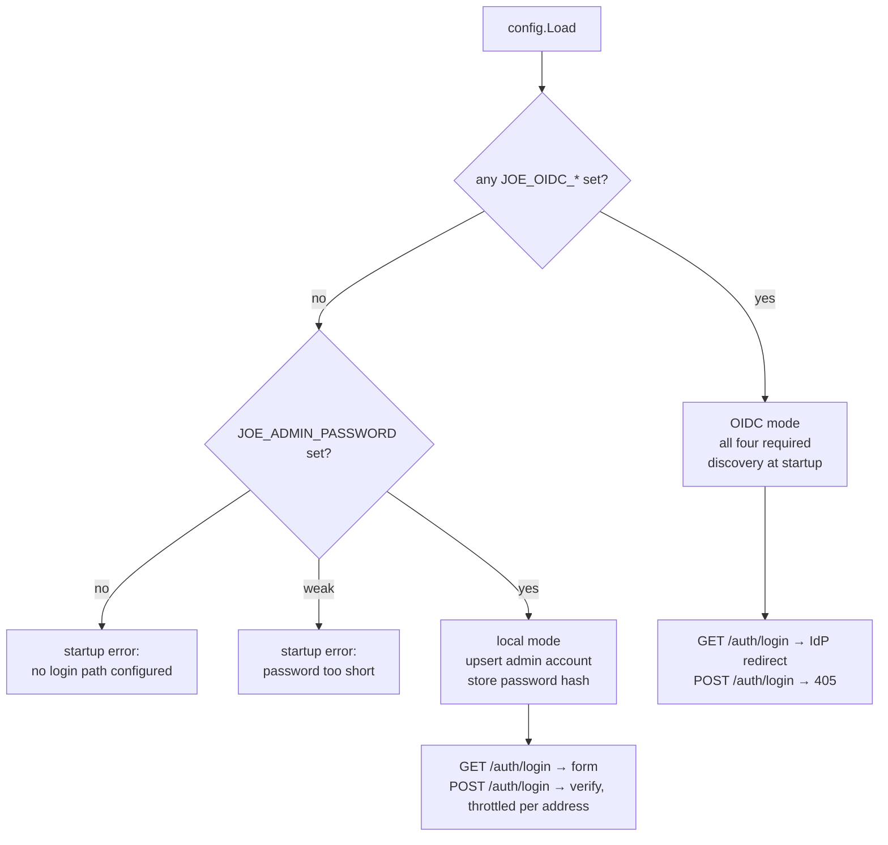

# ADR-0024: Optional OIDC, with a Local Admin Account

## Context and Problem Statement

ADR-0003 made OpenID Connect the sole authentication mechanism, and SPEC-0001 states it as a requirement: "Username/password authentication MUST NOT be implemented." That is the right call for the deployment ADR-0003 imagined — a team or a public instance where many identities matter and an IdP already exists.

It also makes OIDC a startup prerequisite. `config.Load` refuses to serve without `JOE_OIDC_ISSUER`, `JOE_OIDC_CLIENT_ID`, `JOE_OIDC_CLIENT_SECRET` and `JOE_OIDC_REDIRECT_URL`, and the getting-started guide says so. A prospective user who wants to try joe-links, or who runs it at home behind an auth proxy that already decides who gets in, has to stand up Keycloak, Authentik, Pocket ID or Dex before seeing a single link. Issue #230 asks for that gate to be optional: keep OIDC exactly as it is where it is configured, and let an instance with no provider boot and sign in one local administrator with a username and password.

The tension is that ADR-0003's decision driver — no password forms, because passwords are the weak door — is a real security argument, not a preference. An option that lets a password appear beside a working IdP, or that turns joe-links into a user-management product with self-service registration, would be a regression, not a feature.

## Decision Drivers

* **Existing deployments must be untouched.** Nothing an operator with a provider configured does today may change, including what a request can do.
* **No new weak door.** The password path must be impossible to enable by accident, and must never coexist with a working IdP.
* **Still no user management.** joe-links is not becoming an account provider: local mode serves exactly the configured administrator, and self-registration stays out of scope in both modes.
* **Fail loudly at startup.** Ambiguous configuration (half an OIDC setup, a password beside a provider, a guessable password) must stop the process, not degrade quietly.
* **No new dependency** (ADR-0001). Password hashing has to come from the standard library.
* **Provider-agnostic identity stays.** One `users` table keyed on `(provider, subject)` (ADR-0002, ADR-0003) should absorb the local account rather than a parallel account table.

## Considered Options

* **A. Keep OIDC mandatory; document Dex/Pocket ID as a quickstart.** The status quo. Rejected: it answers "how do I run this at home" with "run two servers", and issue #230 is that complaint.
* **B. Ship a default admin password.** Boots with no config at all. Rejected: an instance whose operator never set a credential is serving a published password, and the failure is silent.
* **C. Trust an auth proxy's header (`X-Auth-Request-User` and friends) and skip login entirely.** Attractive for the proxy setups in the issue, but its safety is a property of each operator's proxy config: one missing `auth_request` directive and the header is the caller's to write. Rejected for a default-install product; ADR-0023 already shows how badly header-derived identity ages.
* **D. Local admin account, opt-in, with a derived password hash in the database.** Chosen.
* **E. Local accounts as a general feature: admin creates users, each with a password.** Rejected for now: it is a second identity product next to the IdP one, and nothing in the issue asks for it. The schema leaves room for it (see Consequences) without the product taking on the surface today.

## Decision Outcome

Chosen: **D.** joe-links selects a login path at startup, from the configuration it was actually given.

1. **Mode selection.** Any `JOE_OIDC_*` setting means OIDC mode: the existing requirements still apply to all four, OIDC discovery still runs at startup, and no password is ever checked. No `JOE_OIDC_*` setting at all means local mode. A partial OIDC configuration is an error, not a fallback — the fallback would be the weak door nobody meant to open.
2. **Local mode requires an explicit credential.** `JOE_ADMIN_PASSWORD` (minimum 12 characters) must be set; `JOE_ADMIN_USERNAME` names the account and defaults to `admin`. Neither mode offers signup: in local mode the only account that can sign in is this one.
3. **Configuring both is refused.** `JOE_ADMIN_PASSWORD` beside a configured provider stops startup with an error naming the conflict, because a password next to a working IdP is a second, weaker door the operator did not choose.
4. **The password becomes a hash, and the hash lives in its own table.** At startup the account is upserted into `users` with `provider = 'local'`, `subject = <username>`, role `admin`, and `local_credentials` stores a PBKDF2-HMAC-SHA256 hash (600,000 iterations, 16-byte salt, self-describing `pbkdf2-sha256$<iterations>$<salt>$<digest>`). Plaintext never touches the database, and OIDC users keep no password column at all.
5. **Bootstrapping runs every boot.** Rotating `JOE_ADMIN_PASSWORD` takes effect on the next restart and no stale hash survives the env that set it. The role is granted, never revoked — the same grant-only rule as `JOE_ADMIN_EMAIL` and `JOE_OIDC_ADMIN_GROUPS`, so a demotion made in the admin UI is not undone by a restart, and is not undone by this either.
6. **Login throttling comes with the form.** Failures are counted per client address (resolved as ADR-0023 prescribes, never from an untrusted header) and past 10 in a 5-minute window further attempts get `429` with `Retry-After`. PBKDF2 raises the offline cost; the limiter raises the online one.
7. **`return_url` handling is unchanged**: sanitized to a local path by the same `safeReturnURL` the OIDC callback uses, so the new form cannot become an open redirect.

### Consequences

* Good, because a first-run experience now exists: `JOE_DB_DRIVER=sqlite3 JOE_DB_DSN=joe.db JOE_ADMIN_PASSWORD=… joe-links serve` and nothing else.
* Good, because OIDC deployments see no change at all: no new column on `users`, no new route that answers in their mode, no new startup call.
* Good, because the identity model is intact. A local account is a `users` row like any other, so links, ownership, API tokens, roles and the admin UI work identically in both modes.
* Good, because `local_credentials` rolls back as one `DROP TABLE` and cannot affect OIDC rows.
* Bad, because joe-links now owns password hashing and its parameter hygiene. A stored hash with an unusable cost is refused rather than silently verified — a parameter change is a deliberate act.
* Bad, because the local admin is one account: several people cannot sign in to a local-mode instance, which is the point of the opt-in but is also its ceiling. `local_credentials` is per-user, so raising that ceiling later needs no schema change.
* Bad, behind a shared egress (corporate NAT, VPN) the per-address throttle charges one budget to everyone at that address; the log line names the address so an operator can tell why.
* Neutral, a deployment fronted by an auth proxy may want neither login path. Not served by this ADR: the proxy must let `/auth/*` through, or the operator runs local mode and signs in once.

## Architecture Diagram

## More Information

* Amends ADR-0003, which stays in force for every deployment that configures a provider. Its driver "no username/password forms for identity" now reads: no password forms **where an identity provider is configured**.
* Spec delta: SPEC-0001 "OIDC-Only Authentication" is superseded by "Authentication Mode Selection" and "Local Admin Authentication".
* A local account is `users(provider='local', subject=<username>)`; its hash is `local_credentials.password_hash`.
* Hash cost rationale: OWASP's PBKDF2-HMAC-SHA256 guidance is the reference point; local sign-in is rare, so the ceiling is offline cracking, not per-request latency.
* Related: ADR-0002 (one identity table), ADR-0009 (API tokens are unaffected — they authenticate in both modes), ADR-0023 (the address the throttle keys on).
